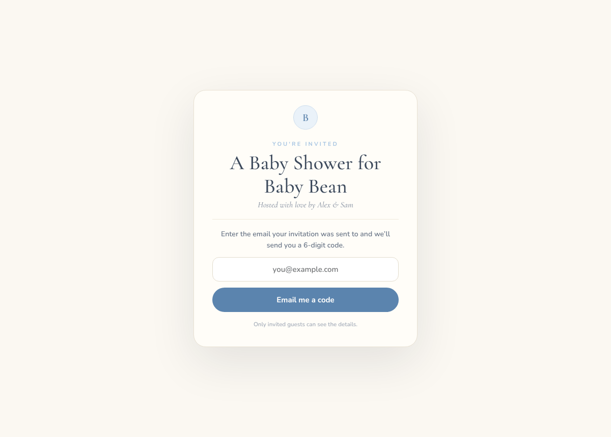
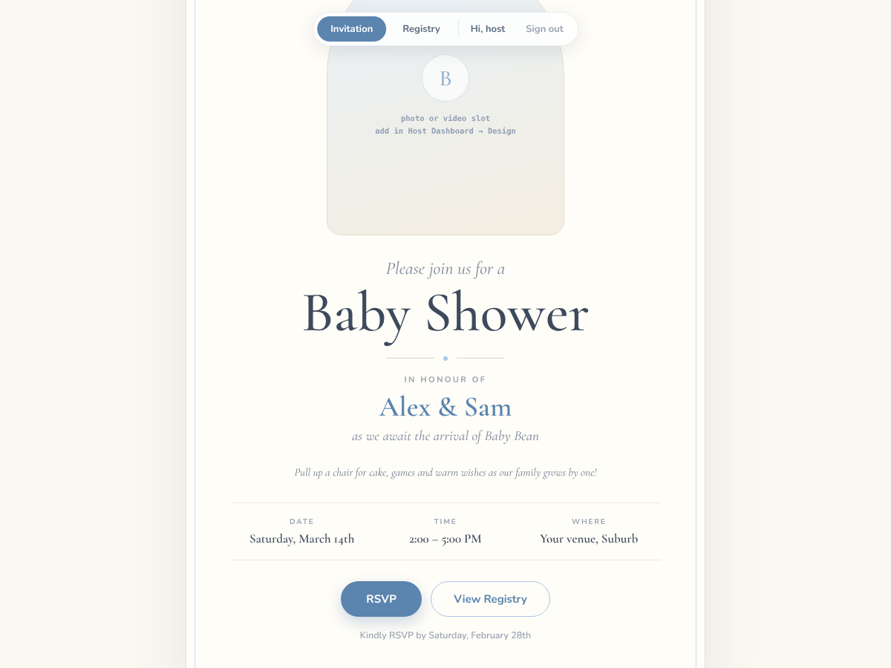
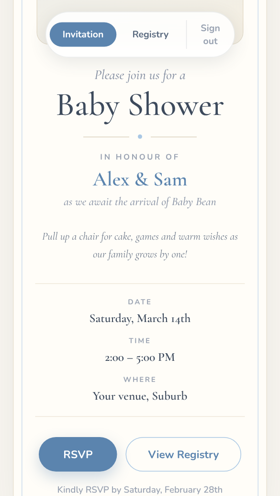
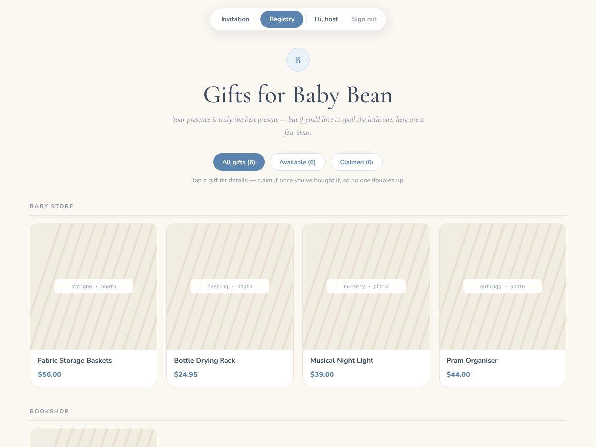
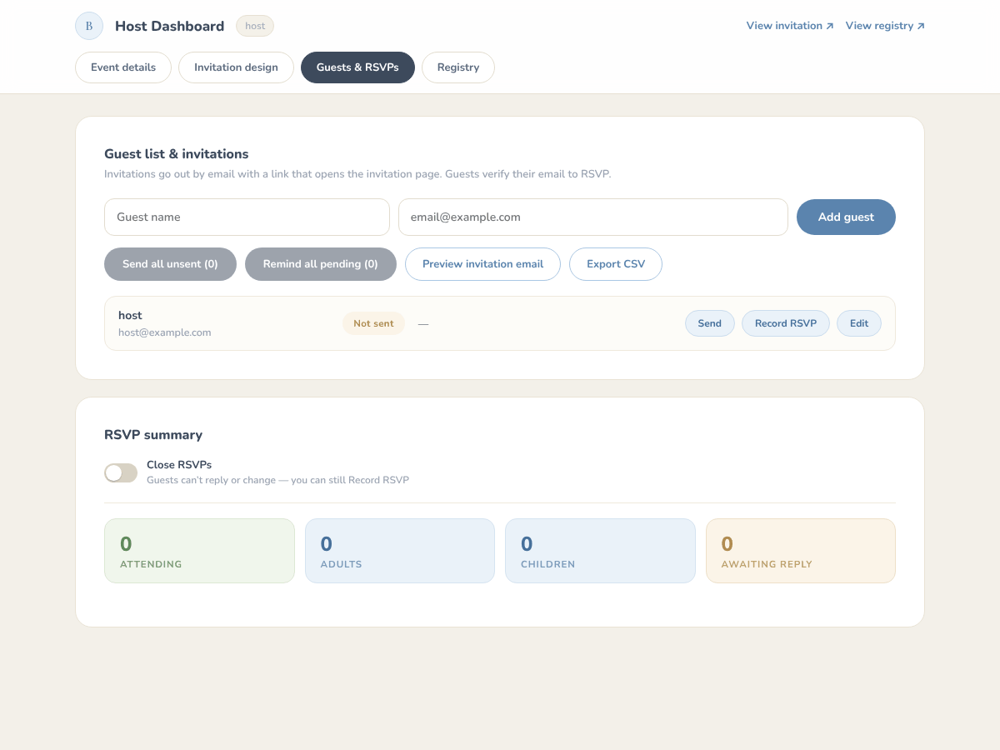
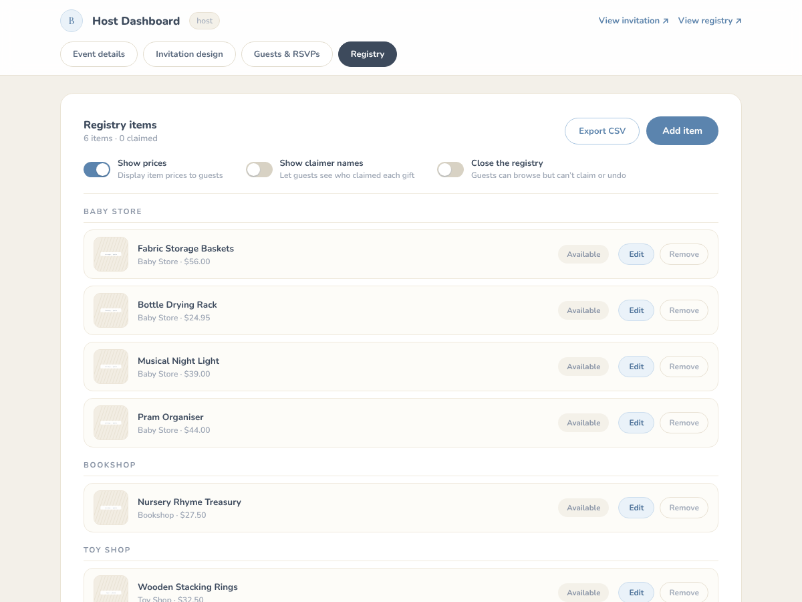

# Baby Shower — Invitation & Registry

A self-hosted website for one baby shower: an animated invitation, RSVPs, and a gift registry where guests claim
gifts so nobody doubles up — plus a dashboard for the hosts. Everyone on the site was invited by a host, so the
**guest list is the whitelist**: guests sign in with the email they were invited at and a 6-digit code, and
there are no accounts or passwords to manage. It runs entirely on Cloudflare (Pages, Pages Functions, KV, R2)
and sends email through Resend.

| Signed out | Invitation (Garden) | On a phone |
|---|---|---|
|  |  |  |

| Registry | Host dashboard — Guests & RSVPs | Host dashboard — Registry |
|---|---|---|
|  |  |  |

*Screenshots show the built-in demo data ("Alex & Sam", "Baby Bean", sample gifts) from a fresh local install, signed
in as the demo host — the "photo or video slot" hint in the empty arch is shown to hosts only.*

## Features

**For guests**
- **An invitation that opens like a letter** — an envelope animation, then the card in one of three themes:
  **Garden** (the default) and **Dreamy Sky**, optionally with the host's own photo or short looping video, and
  **Wisteria Ink**, which is drawn over fixed botanical artwork that this repo does not ship. To use it, put your own
  portrait WebP at exactly `public/themes/wisteria.webp` (gitignored). The card is laid out for a 1200×1691 aspect
  ratio, and the image needs a light, empty area in the middle with its decoration kept to the edges: the text and
  buttons are overlaid in dark olive ink from about 23% down, between roughly 13% from the left and 9% from the
  right. Without the file the Wisteria card shows a plain paper colour.
- **Sign in by emailed code.** Enter the address you were invited at (or tap the link in your invitation) and type
  the 6-digit code. You stay signed in for 7 days, renewed each visit.
- **RSVP** with headcount (adults / children), dietary needs and allergies; reopen it any time to change your answer.
- **Add to calendar** — an `.ics` download and a Google Calendar link, once the host sets a start, end and time zone.
- **Gift registry** grouped by store, filterable (all / available / claimed). Claiming is one tap and is attributed
  to you; your own claims read "Claimed by you" and you can undo them.

**For hosts** — a host is simply a guest whose email is in `HOST_EMAILS`; they get a Host Dashboard link:
- **Event details and messages** — the labels guests read (date, time, venue, map link, RSVP-by), a welcome
  message and a registry welcome (basic Markdown), a personal note for the invitation email, and the structured
  start / end / time zone for Add to calendar.
- **Invitation design** — pick the theme, upload a background photo or video, set its focus point separately for
  desktop and phone, and see a live preview.
- **Guests & RSVPs** — add guests, send invitations one by one or all unsent at once, preview the invitation email,
  send **RSVP reminders** to everyone invited who hasn't replied (skipping anyone emailed in the last 20 hours),
  record an RSVP on a guest's behalf, rename a guest or fix a mistyped email, see the headcount and dietary notes,
  **export CSV**, and **close RSVPs** after the event.
- **Registry** — add and edit gifts (store, brand, price, colour, link, photo upload or image link), **copy
  hotlinked store images into your own storage** (one item or all), show or hide prices and claimer names,
  unclaim on a guest's behalf, a **Received / Thanked** checklist for thank-you notes, **export CSV**, and
  **close the registry** after the event.
- **Email notifications** to the hosts when someone RSVPs, claims a gift, or changes their mind.

## Quick start (local)

You need Node.js 22 or newer. No Cloudflare account is needed to run it locally — `wrangler pages dev` simulates
KV and R2 on your machine.

```bash
npm install
cp wrangler.example.toml wrangler.toml   # deploy config (gitignored); the placeholders are fine locally
cp .dev.vars.example .dev.vars           # local secrets: TOKEN_SECRET, EMAIL_MODE=console, HOST_EMAILS=host@example.com
npm run cf                               # builds, then serves the site and the API on http://localhost:8788
```

Open <http://localhost:8788>, open the envelope, and sign in as **`host@example.com`**. `.dev.vars` sets
`EMAIL_MODE=console`, so emails are printed in the terminal instead of sent, and the sign-in code is also shown on
the page (`devCode`) for convenience — this only happens locally (see [SECURITY.md](SECURITY.md)). There is no
auth bypass: you sign in for real, locally too. A fresh install shows generic demo data until you edit it.

For fast UI work with hot reload: `npm run dev` (Vite on :5173, proxying `/api` to :8788) with `npm run cf:only`
running alongside.

## Tests

```bash
npm test              # unit + API tests (Vitest, ~2 s, no network, no wrangler)
scripts/smoke.sh      # end-to-end check against a running `npm run cf` (BASE=http://localhost:8788 by default)
```

- `npm test` runs `tests/`: the library code (`functions/lib/` — tokens, sessions, the access guard, KV helpers,
  calendar, the hardened image fetch) and the API handlers called directly with an in-memory KV and R2
  (`tests/helpers/env.js`), plus the CSV export in `src/csv.js`.
- `scripts/smoke.sh` walks the real sign-in: health, the signed-out 401s, a host sign-in with the dev code,
  `/api/me` reporting a host, the dashboard and guest APIs, and sign-out. One code per address per minute, so wait
  60 s between runs.

CI (GitHub Actions) runs the build and `npm test` on every push and pull request, plus a gitleaks secret scan.

## Deploy

See **[DEPLOY.md](DEPLOY.md)**: Cloudflare login, KV namespace and R2 bucket, Resend domain verification,
`HOST_EMAILS` / `RESEND_FROM` / `PUBLIC_BASE_URL` in your `wrangler.toml`, the `TOKEN_SECRET` and
`RESEND_API_KEY` secrets, and a checklist for going live.

## How it works

- **Frontend:** React + Vite single-page app (`src/`), path routing (`/`, `/registry`, `/admin`).
- **Backend:** Cloudflare Pages Functions (`functions/`), file-based routing under `functions/api/`.
- **Data:** Cloudflare KV (`BS_KV`). **Media:** Cloudflare R2 (`BS_R2`). **Email:** Resend.

### Sign-in
1. A host adds a guest (name + email) and sends the invitation. The email links to `/?i=<token>`; that token
   names the guest so the code goes to the right mailbox — **it does not sign anyone in**, so a forwarded
   invitation is harmless.
2. The guest opens the envelope and asks for a code. The code goes only to the address on the guest list: six
   digits, 10-minute life, single use, 60 s resend cooldown. After 5 wrong guesses the code is voided and the
   address is locked for 15 minutes — but **requesting a fresh code lifts that lock** (the old code is already dead,
   and the 60 s cooldown still throttles).
3. The code is exchanged for an HttpOnly, SameSite=Lax session cookie: **7 days, sliding**.
4. **A host is a guest whose email is in `HOST_EMAILS`.** Only hosts see the Host Dashboard link; `/admin`
   redirects everyone else and `/api/admin/*` returns 403. Every `HOST_EMAILS` address is always on the guest list,
   so a fresh install is never locked out.

### Pages
- **Landing** (`/`, signed out) — the only public page: an envelope that opens to a teaser (baby + hosts) and a
  sign-in box. No date, time, venue or registry.
- **Invitation** (`/`, signed in) — the chosen theme, event details, Add to calendar, RSVP, link to the registry.
- **Registry** (`/registry`) — the gift grid.
- **Host Dashboard** (`/admin`) — Event details, Invitation design, Guests & RSVPs, Registry.

### Data model (KV)
Host-managed collections are single keys; guest-generated data is per entity (so simultaneous guest writes never
collide on one value). Reads fall back to `functions/lib/seed-data.js` when a key is absent, so the site works
before any edit; the first edit persists over the default. The seed is generic demo data — your real event and
registry live only in KV.

| Key | Writer | Value |
|---|---|---|
| `event` / `design` / `config` | host | event details (display labels + optional `startsAt`/`endsAt`/`tz` for Add to calendar) / theme + background / display switches + close flags (`rsvpClosed`, `registryClosed`) |
| `guests` | host | `[{ id, name, email, sentAt, remindedAt?, sv? }]` — every `HOST_EMAILS` address is always on it; `remindedAt` is the last RSVP reminder (epoch ms); `sv` is the session version, bumped when the host changes the guest's email (missing = 0) |
| `items` | host | gift catalogue |
| `rsvp:<guestId>` | guest / host | `{ attending, adults, kids, dietary, allergies, at }` |
| `claim:<itemId>` | guest (+ host for received / thanked) | `{ guestId, name, at, receivedAt?, thankedAt? }` |
| `code:<emailHash>` | server | one-time sign-in code, 10-min TTL (+ `:cd` cooldown, `:lock` lockout) |
| `send:<YYYY-MM-DD>` | server | site-wide daily sign-in-code budget (2-day TTL) |

Media lives in R2 under random keys; KV stores only the key string. Deleting a guest removes their RSVP and
claims; deleting a gift removes its claim and its image.

## Security

The access model, the security design notes and the accepted risks are in **[SECURITY.md](SECURITY.md)**, along
with how to report a vulnerability privately.

## Known trade-offs

Accepted for a single-event, low-traffic site:

- **What the sign-in does and doesn't cover.** The invitation *email* carries the date, time and venue, so a
  forwarded email reveals them. The sign-in protects the registry, the RSVP list, and anyone who never received an
  email. Uploaded media at `/api/media/*` is served without a session check — keys are random and only ever
  appear inside signed-in responses.
- **KV is eventually consistent with no compare-and-set.** Two guests claiming the *same* gift within the
  propagation window (~60 s) could both succeed (last write wins). Per-item claim keys keep this to that one narrow
  case; true atomicity would need a Durable Object.
- **The `items` / `guests` catalogues are single KV keys.** Two admin edits in different tabs at the same instant
  could lose one update. Fine for a host editing occasionally.
- **KV allows one write per second per key.** "Save external images" therefore copies one item about every 1.1 s
  (with one retry on a 429); a failed row shows its reason and re-running is safe. Adding, editing or removing an
  item or a guest while a bulk run is writing the same key can hit the limit — that write is refused cleanly
  ("Saving too fast — try again in a moment.") and nothing changes.
- **Bulk emails are paced.** "Send all unsent" and "Remind all pending" send 5 emails at a time with a 1 s pause,
  using at most half of Resend's default 10 requests/second (shared with sign-in codes); 30 guests take about 7 s.
  Anything Resend refuses is reported and retried on the next click. Who got an email is recorded after every
  batch, and the server finishes the run even if the page is reloaded, so a second click doesn't mail the same
  people again. If recording fails after the email went out, the dashboard says so instead of reporting an error.
- **Closing RSVPs / the registry is eventually consistent too.** For up to ~60 s after the switch another edge may
  still accept an RSVP or a claim; fix a stray one with Record RSVP or Unclaim, both of which stay open while closed.
- **Editing a guest is a read-modify-write of the single `guests` key.** A send or reminder run finishing in another
  tab at the same moment can undo an edit, including its session revocation — re-apply it if that happens. In the
  same tab, Edit is disabled while a send is running.

## Licence

[MIT](LICENSE).
